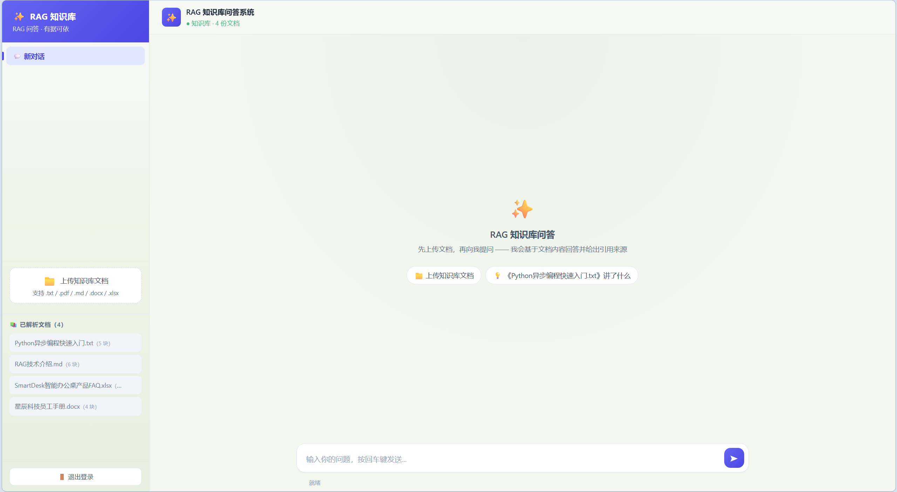
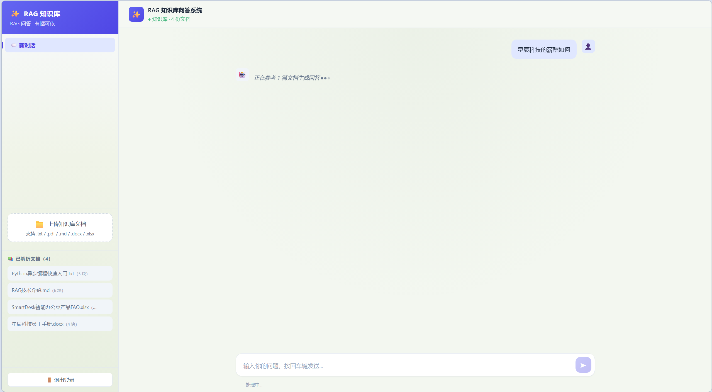
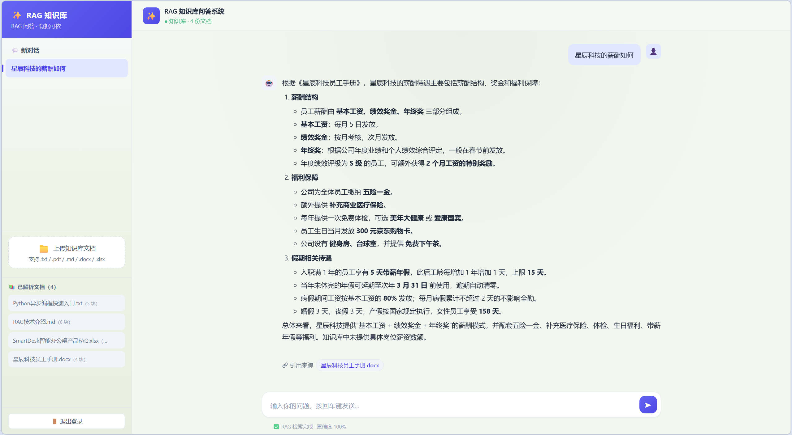

# RAG 知识库问答系统

前后端分离的知识库问答系统：Spring Boot 业务后端（JWT 鉴权 + 会话管理 + 文档管理 + AI 转发）+ Vue 3 前端 + Python RAG 引擎。Java 作为唯一的 API 网关，通过 SSE 透传实现 Token 级打字机效果。

## 特性

- **Java 业务系统 + Python AI 服务（服务化架构）**：Java 网关统一对外（鉴权/审计/转发），Python 引擎作为独立部署的内部能力层，通过 HTTP 契约集成
- **JWT 无状态认证**：jjwt 签发/校验 + BCrypt 密码哈希，简化 RBAC（user/role 两张表），拦截器统一鉴权，`@RequireAdmin` 标注管理员接口
- **会话归属隔离**：业务侧自持会话记录（chat_session + chat_message），用户只能看到自己的会话，列表/详情/删除/聊天全链路校验
- **身份与归属**：会话归属在业务 MySQL（user_id ↔ conversation_id），引擎仅按 conversation_id 维护多轮上下文（checkpoint，会话级状态，无用户体系）；文档的 `uploaded_by` 随文档存在引擎，但只是一个不透明 ID——引擎没有用户表、也不解释角色，删除时靠网关传入的 `X-User-Id` / `X-Can-Delete-Any` 判断"本人或管理员"
- **SSE 流式透传**：Spring 用 `StreamingResponseBody` + `RestClient` 对引擎 SSE 流做逐行原样透传（只劫持 done 事件附加 session_id），前端逐 token 打字机效果 + 实时进度 + 引用来源即时展示
- **引用来源落库**：每轮回答的引用来源 JSON 随消息存入业务库，历史会话回看仍显示来源标签（引擎侧不保留）
- **文档管理**：Java 接收上传（校验扩展名/大小）→ 转发引擎解析（SHA256 去重），列表/删除代理引擎 API，文档生命周期与账号体系统一走网关
- **文档权限**：登录用户都能上传；删除限"本人上传的"或管理员，列表返回 `can_delete` 供前端显隐按钮
- **后台管理**：管理员可查看用户、删除账号（级联清会话、消息与引擎侧对话；不能删自己）
- **容错降级**：AI 服务超时/不可达返回友好提示而非 500；客户端断连静默处理；全局异常统一 `Result` 结构
- **AI 引擎完整能力**：6 节点 LangGraph 管线、混合检索/精排等，见下方「AI 引擎核心链路」（引擎内部细节见 `rag_engine/README.md`）

## 技术栈

| 层       | 技术                                                                                        |
| -------- | ------------------------------------------------------------------------------------------- |
| 前端     | Vue 3 / Vite / axios / fetch（SSE 流式读取）/ markdown-it + DOMPurify（回答渲染）           |
| 业务后端 | Spring Boot 3.5 / MyBatis（注解 + XML）/ MySQL / jjwt / spring-security-crypto / RestClient |
| AI 引擎  | Python FastAPI / LangGraph / LangChain / Qdrant + PostgreSQL / bge-reranker / DashScope Qwen |

## 目录结构

```
rag_system/
├── rag_engine/     Python RAG 引擎（AI 能力层，:8000）
├── backend/         Spring Boot 业务后端（:8081）
│   └── src/main/resources/schema.sql   建表脚本（启动自动执行）
├── frontend/        Vue 3 前端（:5173，开发代理到 :8081）
├── docker-compose.yml       本地开发编排（build 本地构建）
├── docker-compose.prod.yml  生产部署编排（拉取仓库镜像，见「Docker 部署」）
└── .env.example             环境变量模板（真实 .env 不入库）
```

## 系统架构

```
浏览器（Vue 3）
    │  JWT 鉴权（Authorization: Bearer <token>）
    ▼
Spring Boot 业务后端 (:8081)
    ├─ 用户体系：注册/登录/角色（user + role）
    ├─ 会话管理：chat_session + chat_message（业务侧审计记录，含引用来源）
    ├─ 文档管理：/api/documents（上传/列表/删除/查看全文，转发引擎）
    ├─ 后台管理：/api/users（用户列表 / 删除，限管理员）
    ├─ 转发：/api/chat（非流式）、/api/chat/stream（SSE 透传）
    │      │  内部 HTTP（X-User-Id / X-Can-Delete-Any）
    │      ▼
    Python RAG 引擎 (:8000)
    │  LangGraph：分析问题 → 检索文档 → 生成回答（混合检索 + 精排）
    ▼
Qdrant（向量）+ PostgreSQL（checkpoint 多轮上下文 / 文档与对话元数据）
```

## AI 引擎核心链路（rag_engine）

LangGraph 6 节点管线：`对话摘要 → 问题改写 → 文档检索 → 答案生成 → 置信度评估`，另有闲聊、检索为空两条提前结束的分支

- **混合检索**：dense（语义）+ sparse（BM25 关键词）双路召回，Qdrant **服务端** RRF 融合成一次查询；无相关内容时不硬答，走"未找到"话术
- **CrossEncoder 精排**：低分文档直接丢弃（阈值 0.3），"有没有相关内容"由它判断，检索层不做阈值裁剪
- **多轮对话**：自动指代消解 + 超量增量摘要，checkpoint 持久化，重启不丢会话
- **置信度评估**：LLM 五级锚点自评，回答附带引用来源（落库可回看）
- **离线评测**：内置 50 条标注问题集评测脚手架，来源命中率 50/50

引擎完整设计细节见 [rag_engine/README.md](rag_engine/README.md)。

## 界面预览

**文档管理**



**检索提示**



**引用来源**



## 快速开始

### 环境要求

- JDK 17+、Node 18+、Python 3.12+
- MySQL 8+（root 密码通过 `backend/.env` 的 `DB_PASSWORD` 提供，见下方配置步骤）
- PostgreSQL 18（本地开发需要，跑引擎用；Docker 部署由 compose 提供）
- DashScope API Key（rag_engine/.env）

### 配置

先复制两份模板并填入真实值（`.env` 均已 gitignore，不会提交）：

```bash
# AI 引擎密钥（DashScope）
cd rag_engine
copy .env.example .env      # 填入 DASHSCOPE_API_KEY 和 POSTGRES_DSN
cd ..

# 业务后端数据库/密钥
cd backend
copy .env.example .env      # 填入 DB_PASSWORD（MySQL root 密码）、JWT_SECRET
```

### 启动

```bash
# 1. AI 引擎（:8000）
cd rag_engine
python -m venv .venv && .venv\Scripts\activate
pip install -r requirements.txt -i https://mirrors.aliyun.com/pypi/simple/
python main.py

# 2. 业务后端（:8081，自动建库建表 + 预置管理员）
cd backend
.\mvnw.cmd spring-boot:run

# 3. 前端（:5173）
cd frontend
npm install
npm run dev
```

访问 `http://localhost:5173`，默认管理员账号 `admin / admin123`（首次登录后请修改）。

### API 端点

| 方法   | 路径                   | 说明                            |
| ------ | ---------------------- | ------------------------------- |
| POST   | /api/auth/register     | 注册（默认 USER 角色）          |
| POST   | /api/auth/login        | 登录，签发 JWT                  |
| GET    | /api/auth/me           | 当前用户信息                    |
| POST   | /api/sessions          | 创建会话                        |
| GET    | /api/sessions          | 会话列表（分页，仅当前用户）    |
| GET    | /api/sessions/{id}     | 会话详情（含消息 + 引用来源）   |
| DELETE | /api/sessions/{id}     | 删除会话（级联删消息）          |
| GET    | /api/documents         | 文档列表（来自引擎）            |
| POST   | /api/documents/upload  | 上传文档（multipart，转发引擎） |
| GET    | /api/documents/{docId}/content | 文档全文（点引用来源时查看） |
| GET    | /api/documents/{docId}/raw     | 原始文件字节（pdf/docx/xlsx 渲染） |
| DELETE | /api/documents/{docId} | 删除文档（本人或管理员）        |
| GET    | /api/users             | 用户列表（仅管理员）            |
| DELETE | /api/users/{id}        | 删除用户（仅管理员，级联清会话） |
| POST   | /api/chat              | 聊天（非流式，落库）            |
| POST   | /api/chat/stream       | 聊天（SSE 流式，打字机效果）    |

## Docker 部署（可选）

一条命令启动完整系统（MySQL + PostgreSQL + 引擎 + Java 后端 + 前端），无需本地安装 Python/Node/JDK：

```powershell
# 1. 配置：根目录 .env（已 gitignore），复制模板填入真实值
Copy-Item .env.example .env    # 填 DB_PASSWORD、PG_PASSWORD（容器内数据库，随便设）+ DASHSCOPE_API_KEY

# 2. 构建并启动（首次约 10-20 分钟；之后直接 up -d 秒起）
docker compose up -d --build
docker compose logs -f backend    # 看到"已创建默认管理员账号 admin"即就绪
```

访问 `http://localhost:8080`（nginx 托管前端 + 代理 /api，无跨域）。只有这一个端口对外开放，后端与引擎都只在内网；需要直连 API 调试时用 `docker compose exec frontend curl backend:8081/api/...`。

- **架构落地**：只有前端 nginx 暴露宿主端口；backend 与 mysql/postgres/qdrant/engine 都只在内网（"Python 不出内网"在部署层生效），容器间用服务名互访
- **数据**：账号/会话/消息在 mysql 卷；引擎上传的原始文档与 reranker 模型缓存在 engine-data / engine-cache 卷；会话状态与文档元数据在 pg-data 卷；向量在 qdrant-data 卷——`down` 全部保留，`down -v` 才清空；首次问答若需下载重排模型会稍慢，之后不再重复下载
- **结束**：`docker compose stop`（保留现场，下次秒开）或 `docker compose down`

### 镜像化部署（服务器）

完整走过"本地构建 → 推镜像仓库 → 服务器拉取运行"的发布流程（已在阿里云 ECS 实际部署验证）：

```powershell
# 1. 本地构建镜像
docker compose build
# 2. 打标签并推送到镜像仓库（示例为阿里云 ACR，替换为自己的仓库地址）
docker tag rag_system-backend:latest crpi-<实例id>.aliyuncs.com/<命名空间>/rag-backend:latest
docker push crpi-<实例id>.aliyuncs.com/<命名空间>/rag-backend:latest
# 3. 服务器：放置 docker-compose.prod.yml + .env（密钥）后
docker compose -f docker-compose.prod.yml up -d   # 自动拉取镜像并启动
```

与本地版 `docker-compose.yml` 的差异：`build` → `image`（服务器无需源码即可部署）；前端映射 80（开发版默认 8080，可用 `FRONTEND_PORT` 覆盖）；所有服务 `restart: unless-stopped`；镜像地址可用 `.env` 的 `REGISTRY` 变量覆盖（服务器与仓库同地域时走内网拉取更快）。

> 安全提示：默认账号 `admin/admin123` 与 JWT_SECRET 兜底值仅用于本地/演示环境；公网暴露前必须在服务器 `.env` 设置强 `JWT_SECRET` 并修改管理员密码。`.env` 含密钥，切勿提交到仓库或上传公开位置。

## 测试

单元测试聚焦**安全边界与易错分支**（不追求覆盖率），全部用 mock / fake 隔离外部依赖，不依赖数据库、网络与真实向量库，可秒级跑完。

```bash
# 业务后端：JUnit 5 + Mockito（11 个用例）
#   覆盖：JWT 签发/过期/伪造签名、会话归属校验（防越权）、落库内容与标题规则
cd backend && .\mvnw.cmd test

# AI 引擎：pytest（27 个用例）
#   覆盖：文件类型/大小校验、SHA256 去重、索引失败补偿清理、删除顺序与过滤条件、
#         文档归属校验（本人/管理员）、中文 BM25 分词与 TF 长度归一化、chunk 来源注入
cd rag_engine
pip install -r requirements-dev.txt          # 仅测试依赖，不进生产镜像
python -m pytest tests -q
```

## License

MIT
